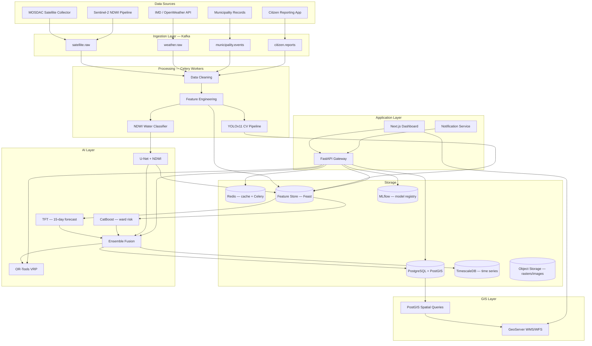
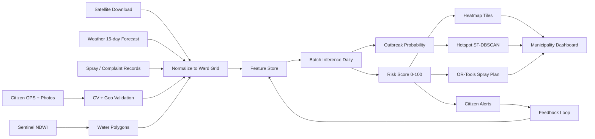
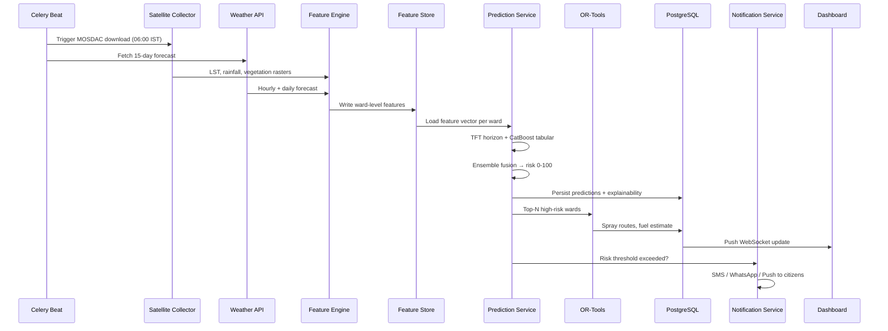
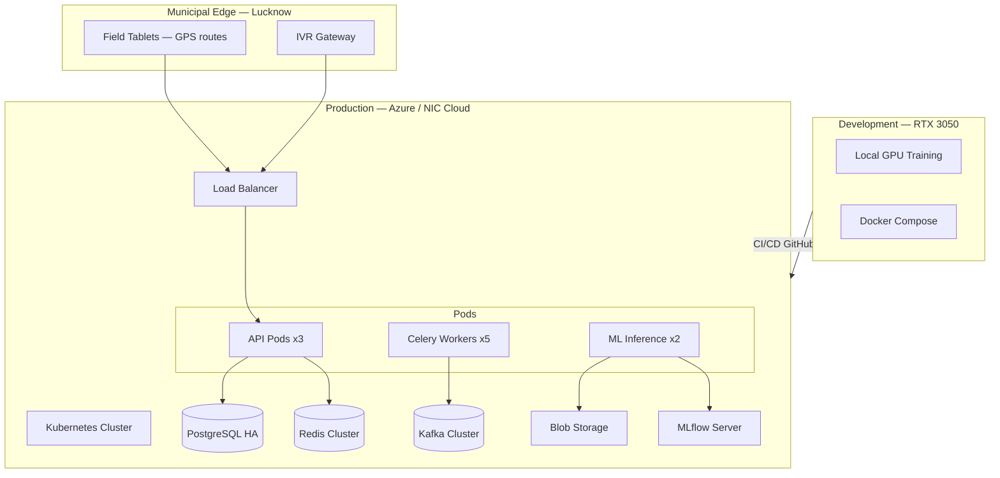

# MosquiSense AI — System Architecture

Government-grade smart city platform for predictive mosquito vector control. Initial deployment: **Lucknow, Uttar Pradesh**. Architecture supports horizontal scaling to **UP** and **India** without redesign.

---

## 1. High-Level Architecture



---

## 2. Data Flow Diagram



---

## 3. Microservices Architecture

| Service | Responsibility | Tech |
|---------|----------------|------|
| `api-gateway` | Auth, routing, rate limit | FastAPI + JWT |
| `satellite-collector` | MOSDAC auto-download | Python + mdapi |
| `weather-collector` | IMD + forecast ingest | Celery beat |
| `ndwi-processor` | Sentinel NDWI polygons | GDAL + U-Net |
| `cv-processor` | Citizen image analysis | YOLOv11 |
| `feature-engine` | Rolling features, anomalies | Pandas + Feast |
| `prediction-service` | TFT + CatBoost + ensemble | PyTorch + CatBoost |
| `optimization-service` | VRP, resource allocation | OR-Tools |
| `notification-service` | SMS, WhatsApp, push, IVR | Twilio, FCM, NIC gateway |
| `gis-service` | GeoServer proxy, tile cache | GeoServer + Redis |
| `analytics-service` | KPIs, cost savings | TimescaleDB queries |
| `retraining-worker` | Weekly/monthly MLflow runs | Celery + DVC |

All services share:
- **PostgreSQL/PostGIS** for transactional + spatial data
- **TimescaleDB** extension for sensor/time-series hypertables
- **Redis** for cache, Celery broker, pub/sub alerts
- **Kafka** for event streaming at state/national scale

---

## 4. Sequence Diagram — Daily Prediction Cycle



---

## 5. Deployment Diagram



---

## 6. Scalability Path (No Architecture Change)

| Stage | Wards | Strategy |
|-------|-------|----------|
| MVP | 1 | Single Celery worker, local Feast |
| Pilot | 10 | Partition Kafka by ward_id |
| Lucknow | ~110 | HPA on inference pods, read replicas |
| UP | ~4,000 | Multi-region K8s, ward sharding in PostGIS |
| India | ~50,000+ | State-level Kafka topics, federated feature store |

**Sharding key:** `state_code + district_code + ward_id` (Bharat geo codes aligned with LGD).

---

## 7. Security Architecture

| Layer | Control |
|-------|---------|
| Authentication | JWT (RS256), refresh tokens, MFA for admins |
| Authorization | RBAC: `super_admin`, `state_admin`, `municipal_officer`, `field_operator`, `citizen`, `analyst` |
| Data at rest | AES-256 (PostgreSQL TDE, blob encryption) |
| Data in transit | TLS 1.3, mTLS between services |
| Audit | Immutable audit log table + SIEM export |
| PII | Citizen phone hashed, photos EXIF-stripped, DPDP Act 2023 compliance |
| Government | STQC-ready logging, air-gapped deployment option |

---

## 8. Backend Stack Detail

```
FastAPI (async) ──► Pydantic v2 schemas
       │
       ├── SQLAlchemy 2.0 + GeoAlchemy2 (PostGIS)
       ├── Celery 5.x + Redis broker
       ├── Kafka (confluent-kafka) — scale path
       └── Prometheus metrics → Grafana dashboards
```

**Clean Architecture layers:**
- `domain/` — entities, value objects (Ward, RiskScore, SprayEvent)
- `application/` — use cases (PredictOutbreak, OptimizeRoute)
- `infrastructure/` — DB repos, MOSDAC client, ML adapters
- `presentation/` — FastAPI routers, WebSocket handlers

---

## 9. Frontend Stack Detail

```
Next.js 14 (App Router)
  ├── React 18 + TypeScript
  ├── Tailwind CSS + shadcn/ui (government accessibility)
  ├── Leaflet + Mapbox GL (ward heatmaps)
  ├── Chart.js (analytics)
  └── React Query (server state)
```

**Dashboard modules:** Risk overview, 15-day forecast, heatmap, spray analytics, fuel/cost savings, complaint trends, satellite layers, weather overlay.

---

## 10. MLOps Pipeline

```mermaid
flowchart LR
    DVC[DVC Data Versioning] --> Train[Training Job]
    Train --> MLflow[MLflow Tracking]
    MLflow --> Reg[Model Registry]
    Reg --> Staging[Staging Deploy]
    Staging --> Val[Backtest + A/B]
    Val --> Prod[Production Promote]
    Prod --> Prom[Prometheus Drift Monitor]
    Prom -->|Drift detected| Retrain[Auto Retrain Trigger]
```



**Retraining schedule:**
- Weekly: CatBoost incremental (new complaints + spray data)
- Monthly: Full TFT retrain with expanded window
- Manual: MLflow run from dashboard (monsoon onset)

---

## 11. GIS Engine

| Component | Role |
|-----------|------|
| PostGIS | Ward boundaries, hotspots, water polygons, routes |
| QGIS | Offline municipal cartography, shapefile import |
| GeoServer | WMS/WFS layers for dashboard |
| Leaflet/Mapbox | Interactive citizen + officer maps |

**Coordinate system:** EPSG:4326 (WGS84) storage, EPSG:7755 (India NSIG) for distance calculations in UP.

---

## 12. Hardware — RTX 3050 Development Profile

| Parameter | Recommendation |
|-----------|----------------|
| GPU VRAM | 4 GB — limits batch sizes |
| Mixed precision | `torch.cuda.amp` autocast FP16 for TFT/U-Net |
| TFT batch size | 32 (hidden_size=64, num_heads=4) |
| U-Net | ResNet34 encoder, batch 8, 512×512 patches |
| YOLOv11 | `yolo11n.pt` — train batch 16, imgsz 640 |
| CatBoost | CPU training — no GPU needed, `iterations=2000` |
| RAM | 16 GB — limit DataLoader workers to 2 |

See [MODEL_SELECTION.md](MODEL_SELECTION.md) for full tuning guide.
