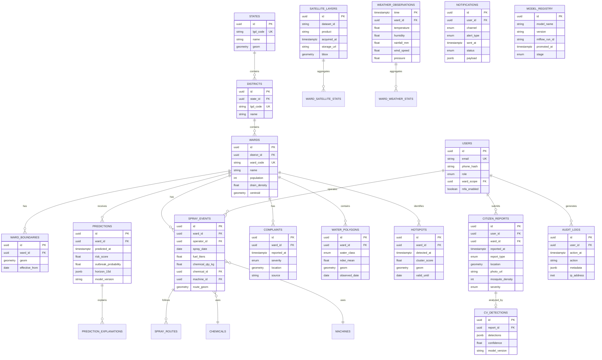

# Database Schema — MosquiSense AI

PostgreSQL 16 + **PostGIS 3.4** + **TimescaleDB 2.x** + Redis 7.

---

## ER Diagram



---

## Core Tables (DDL Summary)

### Spatial Reference

All geometries stored as `GEOMETRY(MultiPolygon, 4326)` or `GEOMETRY(Point, 4326)`. Spatial index: `GIST (geom)`.

### `wards`

| Column | Type | Description |
|--------|------|-------------|
| ward_code | VARCHAR(20) | LMC ward identifier |
| population | INTEGER | Census 2011 + projected |
| drain_density | FLOAT | km drains / km² |
| centroid | POINT | Ward center for alerts |

### `predictions` (TimescaleDB hypertable on `predicted_at`)

| Column | Type | Description |
|--------|------|-------------|
| risk_score | FLOAT | 0-100 calibrated |
| outbreak_probability | FLOAT | 0-1 at day 15 |
| horizon_15d | JSONB | `[{day:1, prob:0.12}, ...]` |
| model_version | VARCHAR | MLflow version tag |

### `spray_events`

| Column | Type | Description |
|--------|------|-------------|
| fuel_liters | FLOAT | Diesel consumed |
| chemical_qty_kg | FLOAT | Larvicide/fogging chemical |
| route_geom | LINESTRING | GPS-tracked fogging route |

### `water_polygons`

| Column | Type | Description |
|--------|------|-------------|
| water_class | ENUM | no_water, moving, temporary, stagnant, flooded |
| ndwi_mean | FLOAT | Mean NDWI within polygon |

### `citizen_reports`

| Column | Type | Description |
|--------|------|-------------|
| report_type | ENUM | mosquito, water_logging, drain, garbage |
| mosquito_density | INT | 1-5 citizen scale |
| photo_url | TEXT | S3/Blob path (EXIF stripped) |

---

## Redis Key Schema

| Key Pattern | TTL | Purpose |
|-------------|-----|---------|
| `risk:ward:{id}` | 1h | Latest risk score cache |
| `forecast:ward:{id}` | 6h | 15-day TFT output |
| `heatmap:tiles:{z}:{x}:{y}` | 24h | Map tile cache |
| `celery-task:{id}` | — | Task status |
| `alert:sent:{user}:{date}` | 24h | Dedup citizen alerts |

---

## Feature Store (Feast)

**Entity:** `ward_id`  
**Feature views:**

| View | Features | TTL |
|------|----------|-----|
| `weather_features` | temp, humidity, rain_7d, rain_15d, humidity_trend | 1 day |
| `satellite_features` | lst, ndwi, ndwi_change, vegetation | 3 days |
| `municipal_features` | spray_gap, complaint_density, last_chemical | 1 day |
| `engineered_features` | breeding_score, drain_score, water_persistence | 1 day |

---

## Indexing Strategy

```sql
CREATE INDEX idx_predictions_ward_time ON predictions (ward_id, predicted_at DESC);
CREATE INDEX idx_spray_ward_date ON spray_events (ward_id, spray_date DESC);
CREATE INDEX idx_complaints_ward_time ON complaints (ward_id, reported_at DESC);
CREATE INDEX idx_water_polygons_geom ON water_polygons USING GIST (geom);
CREATE INDEX idx_hotspots_active ON hotspots (ward_id, valid_until) WHERE valid_until >= CURRENT_DATE;
```

---

## Partitioning (State/National Scale)

- `predictions` — partition by `district_id` (Postgres declarative partitioning)
- `weather_observations` — TimescaleDB chunk interval 7 days
- `audit_logs` — monthly partitions, 7-year retention (government compliance)

---

## Migration Path

Migrations managed by **Alembic** in `database/migrations/`. Initial seed: Lucknow ward shapefiles from LMC Open Data + LGD codes.
