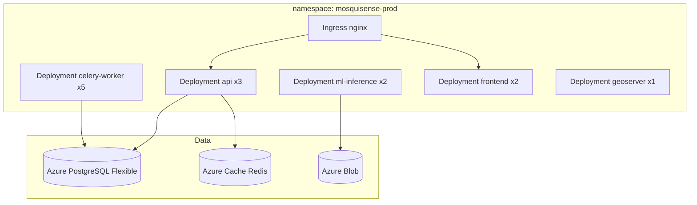

# Deployment Guide — MosquiSense AI

---

## Environments

| Env | Purpose | Infrastructure |
|-----|---------|----------------|
| `dev` | RTX 3050 local | Docker Compose |
| `staging` | LMC UAT | Azure AKS / NIC Cloud 3-node |
| `production` | Lucknow live | Azure AKS HA, PostgreSQL Flexible |

---

## Local Development (RTX 3050)

### Prerequisites

- Docker Desktop 4.x
- Python 3.11+
- Node.js 20 LTS
- NVIDIA drivers + CUDA 12.x
- MOSDAC SSO account ([mosdac.gov.in](https://www.mosdac.gov.in))

### Steps

```bash
# 1. Clone and configure
cp .env.example .env
# Set MOSDAC_USER, MOSDAC_PASS, WEATHER_API_KEY, JWT_SECRET

# 2. Start infrastructure
docker compose -f deployment/docker-compose.yml up -d

# 3. Run migrations
cd database && alembic upgrade head

# 4. Seed Lucknow ward (MVP)
python database/seeds/seed_lucknow_ward.py

# 5. Backend
cd backend && pip install -e ".[dev]"
uvicorn app.main:app --reload --port 8000

# 6. Celery workers
celery -A app.workers.celery_app worker -l info -Q default,satellite,ml
celery -A app.workers.celery_app beat -l info

# 7. Frontend
cd frontend && npm install && npm run dev
```

Access:
- Dashboard: http://localhost:3000
- API docs: http://localhost:8000/docs
- GeoServer: http://localhost:8080/geoserver
- MLflow: http://localhost:5000

---

## Docker Compose Services

| Service | Port | Image |
|---------|------|-------|
| postgres | 5432 | postgis/postgis:16-3.4 |
| redis | 6379 | redis:7-alpine |
| kafka | 9092 | confluentinc/cp-kafka:7.5 |
| geoserver | 8080 | kartoza/geoserver:2.24 |
| mlflow | 5000 | ghcr.io/mlflow/mlflow:v2.10 |
| api | 8000 | mosquisense/api:latest |
| frontend | 3000 | mosquisense/frontend:latest |

---

## Kubernetes Production (Lucknow)



### Helm Values (key)

```yaml
api:
  replicas: 3
  resources:
    requests: { cpu: "500m", memory: "1Gi" }
    limits: { cpu: "2", memory: "2Gi" }
mlInference:
  replicas: 2
  nodeSelector:
    accelerator: nvidia-t4  # cloud GPU optional; CPU fallback supported
postgres:
  external: true
  host: mosquisense-prod.postgres.database.azure.com
  extensions: [postgis, timescaledb]
```

---

## CI/CD — GitHub Actions

`.github/workflows/deploy.yml`:

1. **Lint** — ruff, mypy, eslint
2. **Test** — pytest, jest
3. **Build** — Docker push to ACR
4. **ML validate** — backtest ROC-AUC gate ≥ 0.80
5. **Deploy staging** — helm upgrade staging
6. **Manual approval** — municipal sign-off
7. **Deploy production** — helm upgrade prod

---

## Secrets Management

| Secret | Store |
|--------|-------|
| MOSDAC credentials | Azure Key Vault |
| JWT private key | Key Vault + K8s secret |
| SMS/WhatsApp API | Key Vault |
| DB password | Managed identity (no static pwd in prod) |

---

## Monitoring Stack

| Tool | Purpose |
|------|---------|
| Prometheus | API latency, Celery queue depth, GPU util |
| Grafana | Dashboards: Ops, ML, Municipal KPI |
| Loki | Centralized logs |
| Alertmanager | PagerDuty → LMC NOC |

**Critical alerts:**
- Prediction pipeline missed daily run
- Kafka consumer lag > 10k
- Model inference error rate > 1%

---

## Backup & DR

| Data | RPO | RTO | Method |
|------|-----|-----|--------|
| PostgreSQL | 1h | 4h | Azure PITR + daily geo-redundant backup |
| MLflow models | 24h | 8h | Blob versioning |
| Satellite rasters | 7d | 24h | Re-download from MOSDAC |

DR region: Azure Central India ↔ South India failover.

---

## Lucknow Rollout Checklist

- [ ] LMC ward shapefiles imported (PostGIS)
- [ ] 2 years spray history digitized
- [ ] IMD + MOSDAC pipelines verified 30 days
- [ ] Sentinel-2 NDWI baseline mosaic generated
- [ ] 50 citizen beta testers onboarded
- [ ] NIC SMS gateway provisioned
- [ ] Officer training (2-day workshop)
- [ ] STQC security review scheduled
- [ ] Monsoon go-live date confirmed with LMC

---

## Air-Gapped Deployment (Optional)

For defence-sensitive zones: offline MOSDAC bulk export, local GeoServer, no public cloud — same K8s manifests with `imagePullPolicy: Never` and USB model updates via MLflow export bundle.
