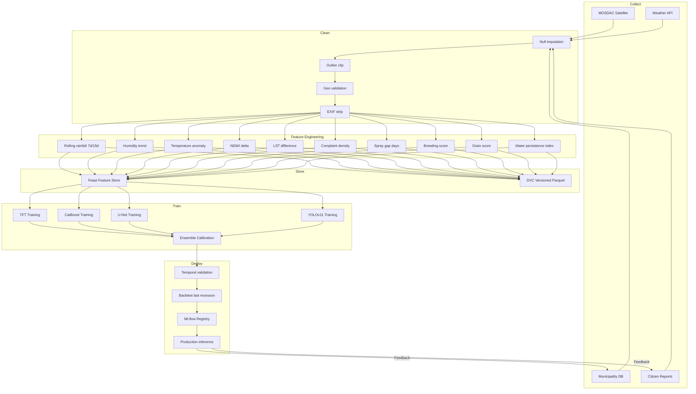
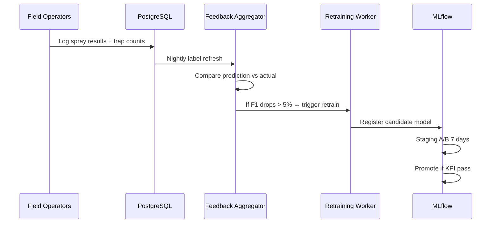

# ML Pipeline — MosquiSense AI

End-to-end pipeline from raw data to retrained production models.

---

## Pipeline Overview



---

## Feature Engineering Specification

| Feature | Formula / Logic | Source |
|---------|-----------------|--------|
| `rain_7d_mm` | Sum GSMaP_ISRO rainfall 7 days | MOSDAC |
| `rain_15d_mm` | Sum rainfall 15 days | MOSDAC |
| `humidity_trend` | Linear slope of daily mean RH | Weather API |
| `temp_anomaly` | T − μ_climatology(month) | Weather + historical |
| `ndwi_change` | NDWI_t − NDWI_{t-7} | Sentinel-2 |
| `lst_diff` | LST_t − LST_{t-1} | MOSDAC |
| `complaint_density` | Count complaints / km² / 7d | Municipality DB |
| `spray_gap_days` | Days since last spray in ward | Spray events |
| `breeding_score` | 0.4×NDWI_stagnant + 0.3×water_persist + 0.3×complaint_norm | Composite |
| `drain_score` | drain_density × open_drain_cv_pct | GIS + YOLO |
| `vegetation_score` | NDVI mean ward | Satellite |
| `water_persistence_index` | Days NDWI > 0.2 in last 30d | NDWI time series |
| `neighbor_mean_risk_7d` | Spatial lag (Queen contiguity) | PostGIS + predictions |

**Label (training target):**

```python
outbreak_label = 1 if (
    trap_density_ae_aegypti > threshold_entomology
    or dengue_cases_ward_7d > 0
    or chikungunya_cases_ward_7d > 0
) within horizon_days=15
```

Ground truth sourced from LMC health department + sentinel trap program (pilot phase).

---

## Training Pipeline

### Schedule

| Job | Frequency | Trigger |
|-----|-----------|---------|
| `train_catboost_incremental` | Weekly (Sunday 02:00 IST) | Celery beat |
| `train_tft_full` | Monthly (1st, 03:00 IST) | Celery beat |
| `train_unet_ndwi` | Monthly | New Sentinel mosaics |
| `train_yolo_active` | Weekly | Active learning queue > 100 images |
| `calibrate_ensemble` | After any head retrain | MLflow webhook |
| `manual_retrain` | On-demand | Dashboard button → MLflow run |

### MLflow Experiment Tracking

```
experiments/
  mosquisense-tft/
  mosquisense-catboost/
  mosquisense-unet/
  mosquisense-yolo/
  mosquisense-ensemble/
```

Logged metrics: ROC-AUC, PR-AUC, F1, RMSE, inference_latency_ms, fuel_saved_simulation.

### DVC Data Pipeline (`training/dvc.yaml`)

```yaml
stages:
  ingest_satellite:
    cmd: python satellite/collector/run_mosdac.py
    outs: [data/raw/satellite/]
  ingest_weather:
    cmd: python backend/app/workers/weather_sync.py
    outs: [data/raw/weather/]
  build_features:
    cmd: python training/feature_engineering/build_features.py
    deps: [data/raw/, database/exports/]
    outs: [data/processed/features.parquet]
  train_tft:
    cmd: python training/train_tft.py
    deps: [data/processed/features.parquet]
    outs: [models/tft/]
    metrics: [metrics/tft.json]
  train_catboost:
    cmd: python training/train_catboost.py
    deps: [data/processed/features.parquet]
    outs: [models/catboost/]
    metrics: [metrics/catboost.json]
```

---

## Validation Strategy

### Temporal Split (no random shuffle)

```
Train: 2019-2023 monsoon seasons
Val:   2024 pre-monsoon + monsoon
Test:  2025 held-out (never seen in tuning)
```

### Walk-Forward Backtest

Simulate daily predictions for last 90 days; measure:
- **Lead time:** days before outbreak that risk > 70
- **Precision@K:** top K wards by risk vs actual outbreaks

### Spatial Cross-Validation

Leave-one-ward-out for Lucknow pilot to detect overfitting to high-complaint wards.

---

## Prediction Service (Inference)

```
Daily 06:30 IST:
  1. Sync features to online store (Feast materialize)
  2. Batch predict all wards (TFT batch + CatBoost matrix)
  3. Fuse ensemble → write predictions table
  4. Run ST-DBSCAN on high-risk points
  5. Trigger OR-Tools for wards with risk > 65
  6. Publish Kafka event prediction.completed
  7. Notification service evaluates alert rules
```

**Latency budget:** 110 wards Lucknow < 30 seconds total on 2 vCPU inference pod.

---

## Retraining Feedback Loop



---

## Model Monitoring (Production)

| Signal | Alert Threshold | Action |
|--------|-----------------|--------|
| Feature drift (PSI) | > 0.2 | Investigate data pipeline |
| Prediction drift | > 0.15 | Schedule retrain |
| Latency p99 | > 500 ms | Scale inference pods |
| Outbreak miss (FN) | Any verified | Post-mortem + label review |

Prometheus exporters in `prediction-service` → Grafana dashboard `MosquiSense-ML`.

---

## Hardware-Optimized Training Commands

```bash
# TFT — mixed precision on RTX 3050
CUDA_VISIBLE_DEVICES=0 python training/train_tft.py \
  --batch-size 32 --fp16 --hidden-size 64 --max-epochs 50

# CatBoost — CPU
python training/train_catboost.py \
  --iterations 2000 --depth 8 --incremental models/catboost/latest.cbm

# YOLOv11n
yolo detect train data=training/yolo/data.yaml model=yolo11n.pt \
  epochs=150 batch=16 imgsz=640 amp=True device=0
```

---

## Directory Layout

```
training/
├── feature_engineering/
│   ├── build_features.py
│   └── spatial_lag.py
├── train_tft.py
├── train_catboost.py
├── train_unet.py
├── train_yolo.py
├── calibrate_ensemble.py
├── validate_backtest.py
├── dvc.yaml
└── configs/
    ├── tft_lucknow.yaml
    └── catboost_lucknow.yaml
```
