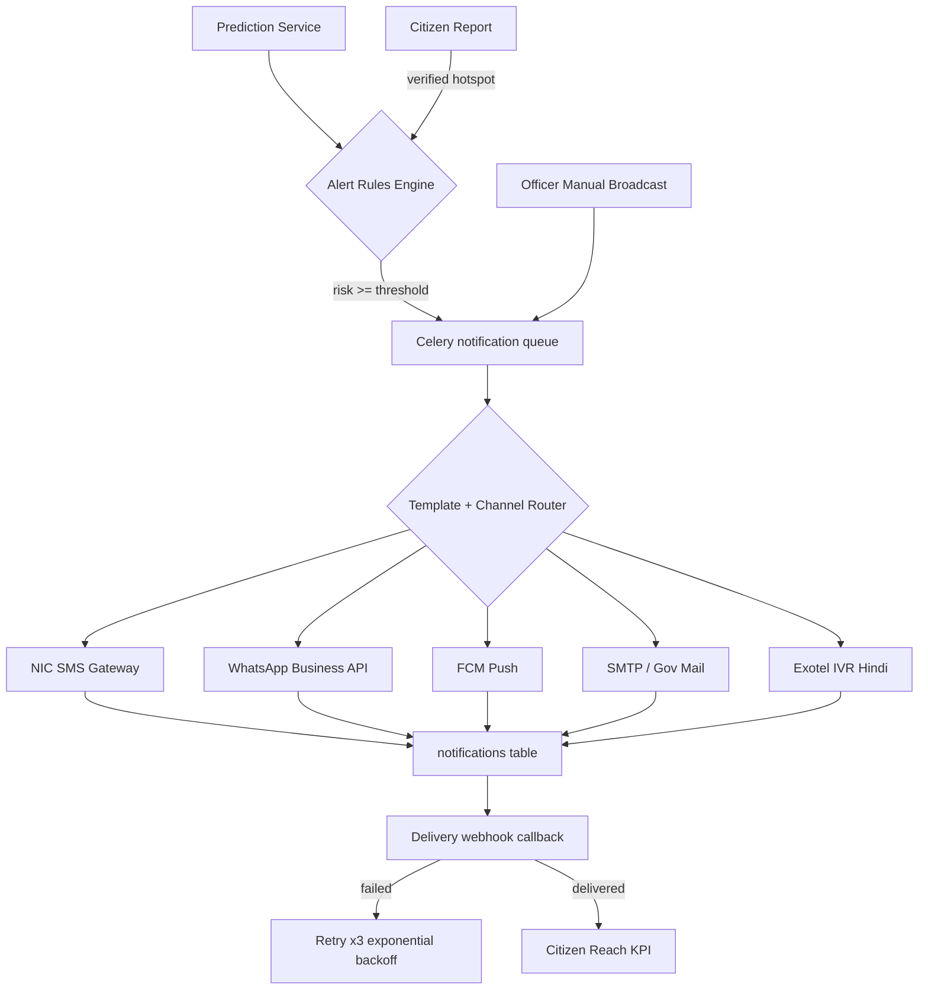
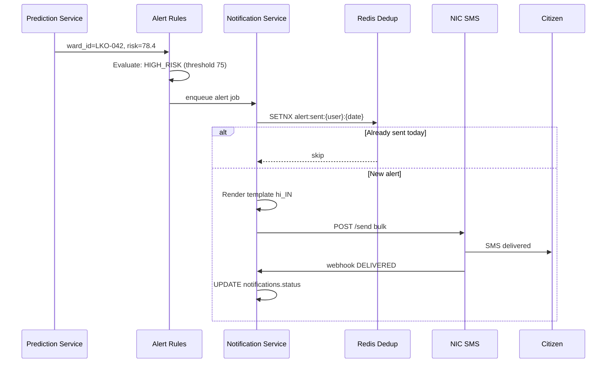

# Notification Workflow — MosquiSense AI

Multi-channel citizen and officer alerting aligned with Japan JIHS "rapid information sharing" framework.

---

## Alert Types

| Type | Trigger | Audience | Priority |
|------|---------|----------|----------|
| `HOTSPOT_NEARBY` | ST-DBSCAN cluster within 500m | Citizens (opt-in) | High |
| `HIGH_RISK_AREA` | Ward risk ≥ 75 | All citizens in ward | High |
| `AVOID_AREA` | Outbreak confirmed + risk ≥ 85 | Citizens in + adjacent wards | Critical |
| `SPRAY_SCHEDULE` | OR-Tools route finalized | Citizens on route buffer | Medium |
| `SPRAY_COMPLETED` | Field operator marks done | Citizens on route | Low |
| `DISEASE_AWARENESS` | Seasonal (pre-monsoon) | All opt-in | Medium |
| `OFFICER_DISPATCH` | Risk ≥ 65 + no spray 14d | Field operators | High |

---

## Workflow Diagram



---

## Sequence — High Risk Alert



---

## Channel Configuration

| Channel | Provider (India) | Rate Limit | Fallback |
|---------|------------------|------------|----------|
| SMS | NIC SMS Gateway / BSNL | 100 msg/sec | Secondary provider |
| WhatsApp | Meta Business + DigiLocker verify | 80 msg/sec | SMS |
| Push | Firebase FCM | 500/sec | SMS if no FCM token |
| Email | Gov SMTP relay | 50/sec | — |
| IVR | Exotel (Hindi + English) | 20 concurrent | SMS summary |

---

## Message Templates (Hindi Example)

**HIGH_RISK_AREA:**
```
[MosquiSense-LMC] आपके वार्ड {ward_name} में मच्छर जोखिम स्कोर {risk}/100 है। 
15 दिन में प्रकोप की संभावना {prob}%. stagnant पानी न हटाएं। सहायता: 104
```

**SPRAY_SCHEDULE:**
```
[MosquiSense] कल {date} {time} से {time_end} तक {street_area} में fogging होगी। 
खिड़कियां बंद रखें। पशु/मधुमक्खी को सुरक्षित स्थान पर रखें।
```

---

## Opt-In / Compliance

- **DPDP Act 2023:** Explicit consent at registration; granular alert preferences
- **TRAI DND:** Transactional template registration for SMS
- **Opt-out:** Reply `STOP` or app settings → `alerts_unsubscribed_at`
- **Quiet hours:** No non-critical alerts 22:00–07:00 IST (configurable)

---

## Officer Notifications

Field operators receive push + SMS for:
- Daily prioritized ward list (OR-Tools output)
- Route GeoJSON deep link to field tablet app
- Fuel/chemical quantity per vehicle assignment

---

## Delivery Status & KPIs

| Status | Description |
|--------|-------------|
| `queued` | In Celery queue |
| `sent` | Provider accepted |
| `delivered` | Webhook confirmed |
| `failed` | Permanent failure after retries |
| `read` | WhatsApp read receipt |

**Citizen Reach KPI:** `delivered / (opt_in_population - unreachable)`

Target: ≥ 80% delivery rate during monsoon.

---

## Implementation

```
notifications/
├── channels/
│   ├── sms_nic.py
│   ├── whatsapp.py
│   ├── fcm_push.py
│   ├── email_smtp.py
│   └── ivr_exotel.py
├── rules/
│   └── alert_engine.py
├── templates/
│   ├── hi_IN/
│   └── en_IN/
└── workers/
    └── notification_tasks.py
```

Celery queue: `notifications` (priority routing for `CRITICAL` alerts).
