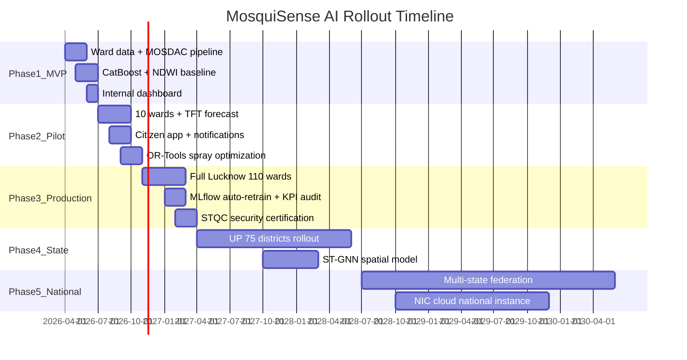

# MosquiSense AI — 5-Phase Roadmap

Realistic timelines for government municipal deployment. Assumes LMC partnership and UP State Health Dept sponsorship.

---

## Phase Overview



---

## Phase 1 — MVP (Months 1–3)

**Scope:** 1 ward in Lucknow (e.g., Ward 42 — high complaint density pilot)

### Milestones

| Week | Milestone | Deliverable |
|------|-----------|-------------|
| 1–2 | Project kickoff with LMC | MoU, data sharing agreement |
| 3–4 | PostGIS ward map + DB schema | Alembic migrations live |
| 5–6 | MOSDAC GSMaP_ISRO + IMD pipeline | Daily automated ingest |
| 7–8 | Sentinel NDWI Module 5 | Stagnant water polygons |
| 9–10 | CatBoost v0.1 + feature store | Risk score 0–100 (no TFT yet) |
| 11–12 | Internal officer dashboard | Heatmap + risk table |

### Success Criteria

- Daily data pipeline 95% uptime
- Risk score correlates with historical complaints (Spearman ρ > 0.5)
- 1 ward NDWI map validated by field team

### Team

4 engineers, 1 GIS specialist, 1 epidemiology advisor (part-time)

---

## Phase 2 — Pilot (Months 4–7)

**Scope:** 10 Lucknow wards, monsoon season validation

### Milestones

| Month | Milestone |
|-------|-----------|
| M4 | TFT 15-day forecast deployed |
| M4 | YOLOv11 citizen photo pipeline |
| M5 | Citizen mobile PWA (report + alerts) |
| M5 | SMS/WhatsApp via NIC gateway |
| M6 | OR-Tools spray route optimization |
| M6 | Fuel/cost savings baseline report |
| M7 | Monsoon backtest report to LMC |

### Success Criteria

- ROC-AUC ≥ 0.78 on 10-ward holdout
- ≥ 10 days median lead time before trap threshold breach
- 500+ citizen reports processed
- ≥ 15% simulated fuel savings vs historical reactive routing

### Budget Estimate

₹45–60 lakh (pilot): infra, 2 fogging vehicle GPS kits, citizen outreach

---

## Phase 3 — Production (Months 8–14)

**Scope:** All ~110 LMC wards, official monsoon 2027 operations

### Milestones

| Quarter | Milestone |
|---------|-----------|
| Q3 2026 | Scale ingest to 110 wards |
| Q4 2026 | Full municipality dashboard + analytics |
| Q1 2027 | MLflow weekly/monthly auto-retrain |
| Q1 2027 | Ensemble v2 (TFT + CatBoost + NDWI) |
| Q2 2027 | STQC / CERT-IN security audit |
| Q2 2027 | Official LMC SOP integration |

### Success Criteria

- ROC-AUC ≥ 0.82 citywide
- 99.5% platform uptime during monsoon
- Documented ₹ fuel + chemical savings ( audited )
- Citizen alert reach ≥ 80% opt-in base

### KPI Dashboard Live

Accuracy, Precision, Recall, F1, ROC-AUC, RMSE, Fuel Saved, Chemical Saved, Citizen Reach, Response Time

---

## Phase 4 — State Scale (Months 15–30)

**Scope:** Uttar Pradesh — 75 districts, ~4,000 urban wards

### Milestones

| Period | Milestone |
|--------|-----------|
| Y2 Q3 | UP State MoU, district onboarding playbook |
| Y2 Q4 | Kafka multi-tenant partitioning by district |
| Y3 Q1 | 20 priority districts (Varanasi, Kanpur, Agra, Meerut…) |
| Y3 Q2 | ST-GNN spatial diffusion model |
| Y3 Q3 | Full UP coverage |
| Y3 Q4 | UP State Health Intelligence Room (SORA-style) |

### Architecture Additions (no redesign)

- Read replicas per geographic zone
- Federated Feast feature store
- District-level admin RBAC
- State-wide GeoServer layer groups

### Success Criteria

- Per-district ROC-AUC ≥ 0.75 (heterogeneous data quality)
- < 60 min daily prediction cycle for full UP

---

## Phase 5 — National Scale (Months 31–54)

**Scope:** Pan-India — smart city + AMRUT + National Vector Borne Disease Control Programme alignment

### Milestones

| Year | Milestone |
|------|-----------|
| Y3 | NIC national cloud deployment template |
| Y3 | Integration with NVBDCP reporting |
| Y4 | 10 states onboarded (climate-diverse validation) |
| Y4 | Multi-lingual citizen alerts (22 scheduled languages) |
| Y5 | 28 states + 8 UTs operational |

### Federation Model

```
National Control Plane (policy, model registry, KPI aggregation)
        │
        ├── State Instance UP (Postgres shard)
        ├── State Instance Maharashtra
        └── State Instance Tamil Nadu
```

Same microservice codebase; state-specific config overlays only.

---

## Risk Register

| Risk | Mitigation |
|------|------------|
| Poor municipal data quality | Digitization sprint + field GPS kits |
| Cloud cover blocks Sentinel | GSMaP rainfall + citizen photos fill gap |
| Citizen low adoption | WhatsApp-first + IVR for non-smartphone users |
| Model drift post-monsoon | Weekly CatBoost incremental + drift monitors |
| Political/data sharing delays | UP State MoU escalates access |

---

## Investment Summary (Indicative)

| Phase | Duration | Est. Cost (INR) |
|-------|----------|-----------------|
| MVP | 3 months | ₹15–20 lakh |
| Pilot | 4 months | ₹45–60 lakh |
| Production (Lucknow) | 7 months | ₹1.2–1.8 crore |
| State (UP) | 18 months | ₹8–12 crore |
| National | 24 months | ₹40–60 crore |

*Excludes ongoing O&M (~15% annual of deployment cost)*

---

## Next Immediate Actions

1. Execute LMC data sharing MoU
2. Register MOSDAC + Copernicus Sentinel accounts
3. Import Ward 42 boundary shapefile
4. Stand up Docker Compose dev environment (`deployment/docker-compose.yml`)
5. Schedule entomology advisor for trap threshold calibration
