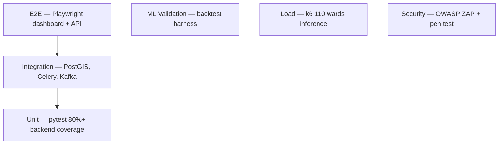

# Testing Strategy — MosquiSense AI

Government platforms require auditable test evidence. Three layers: **software**, **ML**, **operational**.

---

## Test Pyramid



---

## 1. Unit Tests

**Backend (`pytest`):**

| Module | Tests |
|--------|-------|
| `feature_engineering/` | Rolling rain, spray gap, anomaly calc |
| `ndwi/` | NDWI formula, water class thresholds |
| `prediction/` | Ensemble fusion weights sum to 1 |
| `optimization/` | VRP feasible routes, capacity constraints |
| `auth/` | JWT issue/verify, RBAC decorators |
| `notifications/` | Template render, dedup logic |

```bash
cd backend && pytest tests/ -v --cov=app --cov-report=term-missing
```

**Target:** ≥ 80% line coverage on `app/domain` and `app/application`.

**Frontend (`jest` + React Testing Library):**

- Dashboard risk card renders
- Map layer toggle
- Citizen report form validation

---

## 2. Integration Tests

| Test | Description |
|------|-------------|
| `test_mosdac_ingest` | Mock MOSDAC API → satellite_layers table |
| `test_weather_sync` | Mock IMD → TimescaleDB hypertable |
| `test_prediction_pipeline` | Feature store → ML mock → predictions row |
| `test_spray_optimize` | 5 wards → OR-Tools → valid GeoJSON route |
| `test_citizen_report_cv` | Sample image → YOLO mock → cv_detections |
| `test_notification_send` | Mock SMS gateway → notifications status |

Uses **Testcontainers** (PostgreSQL+PostGIS, Redis) in CI.

---

## 3. ML Validation Tests

**Gate for production promotion (GitHub Actions):**

```bash
python training/validate_backtest.py \
  --min-roc-auc 0.80 \
  --min-precision-at-20 0.65 \
  --min-lead-time-days 10
```

| Test | Pass Criteria |
|------|---------------|
| Temporal backtest | ROC-AUC ≥ 0.80 on 2025 holdout |
| Lead time | Median ≥ 10 days before outbreak |
| Spatial CV | Leave-one-ward F1 ≥ 0.70 (pilot) |
| Calibration | Brier score ≤ 0.15 |
| Inference latency | p99 < 500 ms/ward (batch 110) |
| Ensemble stability | Weight change < 0.1 vs previous prod |

**Data tests (Great Expectations):**

- `rain_7d_mm` ≥ 0, no nulls post-imputation
- `risk_score` ∈ [0, 100]
- Ward geometries valid (ST_IsValid)

---

## 4. End-to-End Tests

**Playwright (`frontend/e2e/`):**

1. Officer login → view ward heatmap
2. Trigger manual prediction → risk updates within 60s
3. Citizen OTP login → submit photo report → appears on dashboard
4. Export fuel savings PDF

Run against staging before production deploy.

---

## 5. Load Tests

**k6 scripts (`deployment/load/`):**

| Scenario | Target |
|----------|--------|
| Dashboard API concurrent users | 200 officers, p95 < 2s |
| Batch prediction job | 110 wards < 30s |
| Citizen report burst | 50 uploads/min |
| Notification burst | 10k SMS in 5 min |

---

## 6. Security Tests

| Test | Tool | Frequency |
|------|------|-----------|
| SAST | Bandit, Semgrep | Every PR |
| Dependency scan | Dependabot, pip-audit | Weekly |
| DAST | OWASP ZAP | Pre-production |
| Penetration test | CERT-IN empanelled vendor | Annual |
| RBAC matrix | Custom pytest | Every release |

**RBAC test matrix:** verify `citizen` cannot access `/spray/optimize`, `field_operator` cannot access `/notifications/send`.

---

## 7. GIS Tests

- Ward boundary topology: no overlaps (ST_Overlaps check)
- NDWI polygons within ward bounds
- GeoServer WMS GetMap returns 200 for all configured layers
- Distance calculations use geography type (metres accurate)

---

## 8. Regression Suite

Nightly CI on `main`:
1. Full unit + integration
2. ML backtest (cached features — fast path)
3. Docker compose smoke test

Release branch additional:
4. E2E staging
5. Load test lite (50 users)

---

## Test Data

| Dataset | Location | PII |
|---------|----------|-----|
| Lucknow Ward 42 synthetic | `tests/fixtures/` | None |
| Anonymized spray logs | `tests/fixtures/spray_sample.csv` | Operator IDs hashed |
| Citizen photos | `tests/fixtures/images/` | CC0 stock |

Never commit real citizen PII or production DB exports.

---

## Acceptance Criteria (LMC Sign-off)

- [ ] All P1 integration tests pass
- [ ] ML backtest report reviewed by epidemiology advisor
- [ ] 48-hour staging soak test without errors
- [ ] Security scan: zero critical/high unresolved
- [ ] Officer UAT checklist completed (10 officers)
- [ ] Citizen beta feedback incorporated (≥ 4.0/5 satisfaction)
